# 💰 AWS Cloud — Finance Tracker

[](https://www.terraform.io/)
[](https://aws.amazon.com/)
[](https://www.docker.com/)
[](https://www.python.org/)
[](https://flask.palletsprojects.com/)
[-4479A1?logo=mysql&logoColor=white)](https://www.mysql.com/)
[](LICENSE)

A production-grade, multi-tier personal finance tracking and financial intelligence cloud platform deployed on **Amazon Web Services (AWS)** using **Docker containerization** and **HashiCorp Terraform Infrastructure as Code (IaC)**.

---

## 📑 Table of Contents

1. [Project Overview & Introduction](#1-project-overview--introduction)
2. [Project Objectives](#2-project-objectives)
3. [Complete Application Features](#3-complete-application-features)
4. [Technology Stack](#4-technology-stack)
5. [AWS Cloud Architecture](#5-aws-cloud-architecture)
   - [Architectural Topology Diagram (Mermaid)](#architectural-topology-diagram)
   - [System Architecture Reference](#system-architecture-reference)
6. [AWS Services Implementation Breakdown (9 Services)](#6-aws-services-implementation-breakdown)
7. [Docker Containerization Implementation](#7-docker-containerization-implementation)
8. [Terraform Infrastructure as Code (40 Resources)](#8-terraform-infrastructure-as-code)
9. [Application Architecture & End-to-End Data Flow](#9-application-architecture--end-to-end-data-flow)
10. [Defense-in-Depth Security Implementation](#10-defense-in-depth-security-implementation)
11. [Installation & Local Setup Guide](#11-installation--local-setup-guide)
12. [AWS Deployment Guide](#12-aws-deployment-guide)
13. [Deployment Evidence & Screenshot Catalog](#13-deployment-evidence--screenshot-catalog)
14. [Academic Project Report & Documentation](#14-academic-project-report--documentation)
15. [Application Screenshots](#application-screenshots)

---

## 1. Project Overview & Introduction

The **AWS Cloud – Finance Tracker** is an end-to-end cloud engineering project that bridges full-stack web development, container runtime management, cloud architecture, and automated infrastructure provisioning.

Originally conceived as a local Flask application, the platform was systematically re-architected, hardened, containerized, and deployed to an air-gapped Virtual Private Cloud (VPC) in the AWS Mumbai region (`ap-south-1`). It provides real-time financial tracking, automated multi-file CSV transaction ingestion with cryptographic deduplication, category-based budget governance with visual progress tracking, portfolio valuation, historical net worth tracking, and server-side encrypted monthly report exports to Amazon S3 via time-limited presigned URLs.

The platform eliminates administrative attack surfaces by closing traditional SSH (port 22) entirely, relying instead on **AWS Systems Manager Session Manager** and instance profile role delegation. Sensitive credentials, database connection strings, and SMTP tokens are stored exclusively in **AWS Systems Manager Parameter Store** with KMS envelope encryption.

---

## 2. Project Objectives

- **Cloud Infrastructure as Code (IaC):** Codify 100% of the AWS infrastructure using HashiCorp Terraform modules, enabling automated, repeatable, zero-drift provisioning.
- **Air-Gapped Network Isolation:** Enforce multi-tier network segregation by hosting the web compute tier in a public subnet and isolating the relational database in private subnets with no route to the internet.
- **Immutable Container Packaging:** Package the Flask application and Gunicorn WSGI server into an unprivileged Docker container running as a non-root system user (`appuser`).
- **Zero Hardcoded Credentials:** Eliminate static keys and credentials from codebase and container layers, hydrating configuration dynamically at runtime via AWS Systems Manager Parameter Store.
- **Least-Privilege Role Delegation:** Implement fine-grained IAM instance profiles, scoping S3, SSM, and CloudWatch permissions strictly to required resource ARNs.
- **Defensive Application Security:** Protect user data against Cross-Site Request Forgery (CSRF), Host Header Poisoning, Account Enumeration, and Spreadsheet Formula Injection (CWE-1236).
- **Proactive Cost & Quota Governance:** Implement an automated $20.00 USD monthly AWS Budgets guardrail with multi-threshold alerting to ensure strict educational cost control.

---

## 3. Complete Application Features

| Feature | Technical Implementation | Operational Description |
| :--- | :--- | :--- |
| **Authentication & Session Security** | Flask-Login + Werkzeug | User registration, login, and logout. Passwords hashed using `pbkdf2:sha256`. Session cookies protected with Flask-WTF CSRF tokens. |
| **Password Reset via Gmail SMTP** | `secrets.token_hex(16)` + Gmail TLS | Cryptographically secure 32-character tokens with 1-hour expiration. Link construction enforced via `APPLICATION_URL` to block Host Header Poisoning. Outbound emails delivered via Gmail SMTP (`smtp.gmail.com:587`). |
| **Multi-Tenant Data Isolation** | SQLAlchemy ORM Filtering | Strict logical tenant separation. Every query filters on `user_id == current_user.id`. Report paths validated via regex against path traversal (`..`). |
| **CSV Transaction Ingestion** | Custom Multi-Schema Parser | Supports bulk ingestion of bank statements, net worth snapshots, and investment holdings with automated header detection and schema validation. |
| **Idempotent Deduplication** | MD5 Fingerprinting | Computes an MD5 fingerprint hash: `MD5(user_id:date:amount:desc:category:type)`. MySQL indexed fingerprint lookup prevents duplicate entries across multiple CSV uploads. |
| **Category Budget Governance** | Dynamic Variance Calculation | Allows setting monthly spending limits per category. Displays interactive, color-coded progress bars (Normal, Approaching Limit, Over Budget) and variance notifications. |
| **Investment Portfolio & Valuation** | YFinance + Heuristic Fallback | Tracks equity tickers, shares held, purchase cost basis, live market prices, unrealized gain/loss ($), and percentage return. |
| **Net Worth Historical Ledger** | Asset & Liability Tracking | Records periodic balance sheet snapshots, computing total net worth growth and trajectory over time. |
| **Interactive Data Visualizations** | Plotly.js Interactive Charts | Visualizes monthly cash flow (income vs. expense bars), net worth trends (area chart), and portfolio asset allocation (donut chart). |
| **Amazon S3 Monthly Reports** | Boto3 + SSE-S3 AES-256 | Exports monthly transaction ledgers in CSV format to Amazon S3. Automatically creates half-open date intervals, uploads with server-side encryption, and provides 15-minute presigned URLs for secure downloads. |
| **Spreadsheet Injection Defense** | CWE-1236 Sanitization | Sanitizes text fields starting with `=`, `+`, `-`, `@`, `\t`, or `\r` by prefixing a single quote (`'`), neutralizing malicious formulas in Excel and Google Sheets. |
| **Hybrid Financial Health AI** | Gemini API + Heuristic Engine | Generates a 0–100 Financial Health Score based on savings rate, emergency fund coverage, and debt-to-income metrics. Delivers AI insights via Google Gemini API with fallback to deterministic heuristic rules. |
| **Scoped Data Reset Utilities** | User-Scoped Data Purge | Allows users to selectively purge transactions, portfolios, or all personal records without affecting other platform users. |

---

## 4. Technology Stack

### Backend & Application Runtime
- **Language:** Python 3.11
- **Web Framework:** Flask 3.0.0
- **WSGI Server:** Gunicorn 21.2.0 (2 Worker Processes, 4 Threads per worker)
- **ORM & Database Driver:** Flask-SQLAlchemy 3.1.1, SQLAlchemy 2.0, PyMySQL 1.1.0, Cryptography
- **Authentication & CSRF:** Flask-Login 0.6.3, Flask-WTF 1.2.1, WTForms 3.1.2
- **AWS SDK:** Boto3 1.34.0, Botocore 1.34.0
- **Data Analytics & Charts:** Plotly 5.18.0, Pandas 2.1.4, YFinance 0.2.33

### Frontend & User Interface
- **Templates:** Jinja2 3.1.2
- **Styling & Layout:** Tailwind CSS & Bootstrap 5
- **Interactive Visualizations:** Plotly.js JavaScript Client

### Infrastructure & Cloud Platform
- **Cloud Provider:** Amazon Web Services (AWS)
- **Infrastructure as Code:** HashiCorp Terraform (v1.5+, AWS Provider ~> 5.0)
- **Containerization:** Docker & Docker Compose
- **Target OS:** Amazon Linux 2023 (`al2023-ami`)

---

## 5. AWS Cloud Architecture

### Architectural Topology Diagram

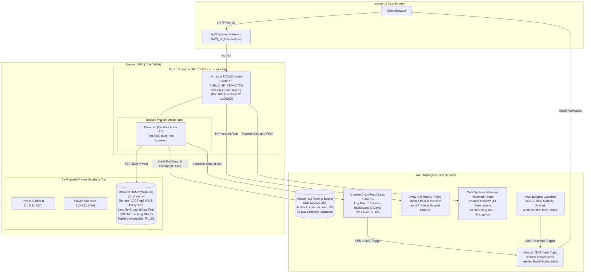

### System Architecture Reference
The production architecture is captured in the high-resolution reference diagram below:

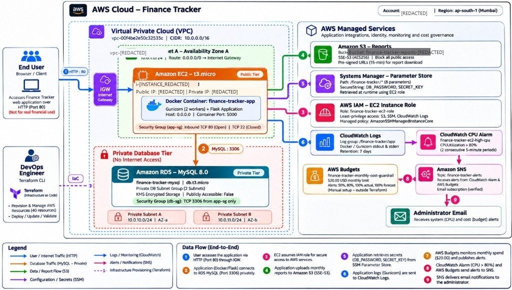

---

## 6. AWS Services Implementation Breakdown

The cloud environment incorporates nine integrated AWS services configured according to enterprise best practices:

### 1. Amazon Elastic Compute Cloud (EC2)
- **Role:** Web server and Docker container host.
- **Specifications:** `t3.micro` instance running Amazon Linux 2023 with 20 GB gp3 encrypted storage.
- **Security Posture:** SSH (port 22) is completely omitted. Instance enforces **IMDSv2** (`http_tokens = "required"`, hop limit 1), eliminating SSRF-based metadata attacks.

### 2. Amazon Virtual Private Cloud (VPC)
- **Role:** Multi-tier network isolation.
- **Specifications:** CIDR `10.0.0.0/16` divided into 1 public subnet (`10.0.1.0/24`) and 2 private subnets across two AZs (`10.0.10.0/24` in `ap-south-1a`, `10.0.11.0/24` in `ap-south-1b`).
- **Security Posture:** Database subnets have zero route table entries to the Internet Gateway, creating an air-gapped data tier without direct internet access.

### 3. Amazon Relational Database Service (RDS) MySQL
- **Role:** Managed relational persistence for transactions, users, and budgets.
- **Specifications:** MySQL 8.0 running on `db.t3.micro` with 20 GB gp3 storage.
- **Security Posture:** `PubliclyAccessible = false`. Storage encrypted at rest via AWS KMS (`alias/aws/rds`). Security group `db-sg` accepts port 3306 traffic exclusively from `app-sg`.

### 4. Amazon Simple Storage Service (S3)
- **Role:** Server-side encrypted storage for monthly transaction CSV exports.
- **Specifications:** Private bucket `finance-tracker-reports-S3_BUCKET_REDACTED` with default SSE-S3 AES-256 encryption.
- **Security Posture:** All 4 Block Public Access settings enabled (`true`). Objects expire automatically after 30 days. Access is granted exclusively via 15-minute presigned download URLs.

### 5. AWS Identity and Access Management (IAM)
- **Role:** Fine-grained role delegation without static API access keys.
- **Specifications:** Instance role `finance-tracker-ec2-role` with `AmazonSSMManagedInstanceCore` and 3 scoped inline policies.
- **Security Posture:** S3 permissions restricted to the specific bucket ARN; SSM permissions restricted to `/finance-tracker/*`; CloudWatch Logs permissions restricted to `/finance-tracker/app:*`.

### 6. AWS Systems Manager (SSM) Parameter Store
- **Role:** Centralized secrets and runtime configuration management.
- **Specifications:** 14 parameters stored under `/finance-tracker/*`.
- **Security Posture:** Sensitive values (`DB_PASSWORD`, `SECRET_KEY`, `MAIL_PASSWORD`) are encrypted with AWS KMS (`SecureString`). Retrieved dynamically at container boot time.

### 7. Amazon CloudWatch
- **Role:** Container log aggregation and infrastructure performance alerting.
- **Specifications:** Log group `/finance-tracker/app` with 7-day retention. Metric alarm `finance-tracker-ec2-high-cpu` monitors CPU utilization > 80% over two 300-second evaluation periods.
- **Security Posture:** Tamper-resistant centralized logging; application logs are sanitized before emission.

### 8. Amazon Simple Notification Service (SNS)
- **Role:** Pub/Sub alert fanout hub.
- **Specifications:** Topic `finance-tracker-alerts` with verified email delivery.
- **Security Posture:** Scoped topic access policy granting publish permissions exclusively to CloudWatch Alarms and AWS Budgets.

### 9. AWS Budgets
- **Role:** Educational financial governance and cost guardrails.
- **Specifications:** Monthly cost limit of $20.00 USD with 4 alert triggers (50%, 80%, 100% actual spend, and 100% forecasted spend) routing warnings to SNS.
- **Security Posture:** Non-destructive warning governance preventing accidental cost accumulation without disrupting viva demonstrations.

---

## 7. Docker Containerization Implementation

The application is containerized to guarantee identical execution across development and AWS production environments.

### Dockerfile Hardening Highlights
- **Base Image:** `python:3.11-slim` for minimal vulnerability attack surface.
- **Non-Root Execution:** Establishes dedicated system user `appuser` (UID 1000) and group `appuser`. The container never executes with root privileges.
- **Automated Healthcheck:** Built-in Python healthcheck probes `http://localhost:5000/` every 30 seconds.
- **Layer Optimization:** Dependency installation (`requirements.txt`) cached independently from application source code.

### Startup & Database Readiness (`entrypoint.sh`)
- Implements a bounded connection retry loop (up to 15 attempts with 2-second backoff) verifying MySQL readiness.
- Automatically executes SQLAlchemy `db.create_all()` within application context before handing process execution to Gunicorn.
- Sanitizes database errors, preventing connection strings or passwords from being logged.

---

## 8. Terraform Infrastructure as Code

The entire cloud infrastructure is codified using declarative HashiCorp Terraform modules located in the `terraform/` directory:

```
terraform/
├── app/                                     # Core Application Infrastructure (40 Resources)
│   ├── cloudwatch.tf                        # Log groups and metric alarms
│   ├── ec2.tf                               # EC2 host, Elastic IP, and IMDSv2 configuration
│   ├── iam.tf                               # IAM instance role and 3 scoped inline policies
│   ├── outputs.tf                           # Exported endpoints and resource IDs
│   ├── rds.tf                               # RDS MySQL, DB subnet group, and KMS encryption
│   ├── s3.tf                                # S3 reports bucket, lifecycle rules, public access block
│   ├── sns.tf                               # Alerting topic and email subscription
│   ├── ssm.tf                               # 8 Parameter Store configuration values
│   ├── terraform.tfvars.example             # Sanitized variables template
│   ├── variables.tf                         # Input variable declarations
│   ├── versions.tf                          # Provider requirements (Terraform >= 1.5.0, AWS ~> 5.0)
│   ├── vpc.tf                               # VPC, 3 subnets, IGW, route tables, and security groups
│   └── scripts/user_data.sh                 # EC2 automated bootstrap script
│
└── budget/                                  # Financial Governance Module (4 Resources)
    ├── budgets.tf                           # $20.00 USD budget and 4 notification triggers
    ├── outputs.tf                           # Exported budget ARNs
    ├── sns.tf                               # Budget alerting SNS topic and resource policy
    ├── terraform.tfvars.example             # Sanitized budget variables template
    ├── variables.tf                         # Budget variable declarations
    └── versions.tf                          # Provider requirements
```

*Total Managed Resources:* Exactly **40 resources** in `terraform/app` and **4 resources** in `terraform/budget`. State files and binary execution plans (`*.tfplan`) are strictly excluded from version control to prevent credential exposure.

---

## 9. Application Architecture & End-to-End Data Flow

```
1. Client Browser (Port 80)
      │
      ▼
2. Internet Gateway (IGW_ID_REDACTED)
      │
      ▼
3. Public Subnet A (Route Table: 0.0.0.0/0 -> IGW)
      │
      ▼
4. EC2 Instance (t3.micro / APP_SG_ID_REDACTED)
   - Port 80 Inbound Forwarded to Docker Port 5000
   - SSH Port 22 Completely Closed
      │
      ▼
5. Gunicorn WSGI + Flask 3.0 (Non-Root User: appuser)
      │
      ├──────────────────┬──────────────────┬──────────────────┐
      ▼                  ▼                  ▼                  ▼
6. RDS MySQL 8.0   7. Amazon S3       8. SSM Parameter   9. CloudWatch
   - Port 3306        - SSE-S3 AES-256   - Encrypted KMS    - /finance-tracker/app
   - Private Subnets  - 30-Day Expiry    - Runtime Hydrate  - CPU > 80% Alarm
   - KMS Storage Enc  - 15-Min Presign                      - Triggers SNS
```

---

## 10. Defense-in-Depth Security Implementation

| Security Boundary | Defensive Mechanism | Risk Mitigated |
| :--- | :--- | :--- |
| **Network Perimeter** | Port 22 SSH completely omitted from public security group. | Eliminates SSH brute-force, dictionary attacks, and credential stuffing. |
| **Administration** | AWS Systems Manager Session Manager with IAM authentication. | Replaces unmanaged `.pem` SSH keys with authenticated, auditable TLS browser tunnels. |
| **Data Tier Isolation** | RDS deployed in private subnets with no IGW route; port 3306 restricted to `app-sg`. | Neutralizes direct external database attacks and SQL port scanning. |
| **Compute Hardening** | IMDSv2 enforced (`http_tokens = "required"`, hop limit 1). | Neutralizes Server-Side Request Forgery (SSRF) aimed at stealing IAM instance metadata. |
| **Container Hardening** | Docker executes as dedicated unprivileged `appuser` (UID 1000). | Mitigates container breakout attacks from obtaining host root privileges. |
| **Secrets Governance** | KMS envelope encryption (`SecureString`) in SSM Parameter Store. | Eliminates static credentials from source code, Git history, and Docker layers. |
| **Web Application Security** | Flask-WTF CSRF tokens on all POST/DELETE forms. | Protects authenticated user sessions against Cross-Site Request Forgery. |
| **Spreadsheet Defense** | CWE-1236 sanitization prepending `'` to formula triggers. | Protects users from Formula Injection when opening exported CSV reports. |
| **Authentication Defense** | `secrets.token_hex(16)` with 1-hr TTL; explicit `APPLICATION_URL`. | Neutralizes password reset token guessing and Host Header Poisoning attacks. |
| **Cost Governance** | AWS Budgets $20.00 USD monthly limit with multi-tier alerts. | Prevents unexpected cloud expenditure during development and academic viva evaluation. |

---

## 11. Installation & Local Setup Guide

### Prerequisites
- Python 3.11+
- Git
- Docker & Docker Compose (Optional for container testing)

### Step 1: Clone Repository
```bash
git clone https://github.com/vedank26/Finance-Tracker.git
cd Finance-Tracker
```

### Step 2: Set Up Virtual Environment
```bash
python -m venv venv
# On Windows:
venv\Scripts\activate
# On Linux/macOS:
source venv/bin/activate
```

### Step 3: Install Dependencies
```bash
pip install --upgrade pip
pip install -r requirements.txt
```

### Step 4: Configure Local Environment Variables
Copy `.env.example` to `.env`:
```bash
cp .env.example .env
```
Update `.env` with local development settings:
```ini
FLASK_ENV=development
SECRET_KEY=local-dev-secret-key-change-me-32-chars
SQLALCHEMY_DATABASE_URI=sqlite:///finance.db
```

### Step 5: Initialize Database & Run Locally
```bash
python app.py
```
Open your browser and navigate to `http://127.0.0.1:5000/`.

---

## 12. AWS Deployment Guide

Deploying the entire infrastructure from scratch using Terraform:

### Step 1: Configure AWS CLI Credentials
Ensure your terminal has authorized AWS administrator credentials:
```bash
aws sts get-caller-identity
```

### Step 2: Deploy Budget Guardrail Module
```bash
cd terraform/budget
cp terraform.tfvars.example terraform.tfvars
# Update notification email in terraform.tfvars
terraform init
terraform apply
```

### Step 3: Deploy Core Application Infrastructure
```bash
cd ../app
cp terraform.tfvars.example terraform.tfvars
# Update db_password and app_secret_key in terraform.tfvars
terraform init
terraform apply
```
*Terraform will output the EC2 Public IP, RDS Endpoint, S3 Bucket Name, and SSM Prefix.*

---

## 13. Deployment Evidence & Screenshot Catalog

Comprehensive technical verification artifacts proving the live AWS deployment are cataloged in [`docs/final-evidence/`](docs/final-evidence/):

- [`docs/final-evidence/01-ec2/`](docs/final-evidence/01-ec2/): EC2 API payload and 2/2 status check proof.
- [`docs/final-evidence/02-vpc/`](docs/final-evidence/02-vpc/): Subnets, route tables, and security group rules.
- [`docs/final-evidence/03-rds-mysql/`](docs/final-evidence/03-rds-mysql/): MySQL instance specs and KMS storage encryption proof.
- [`docs/final-evidence/04-s3/`](docs/final-evidence/04-s3/): S3 Block Public Access, SSE-S3 encryption, and demonstration report list.
- [`docs/final-evidence/05-iam/`](docs/final-evidence/05-iam/): EC2 IAM role trust policies and scoped inline policies.
- [`docs/final-evidence/06-ssm-parameter-store/`](docs/final-evidence/06-ssm-parameter-store/): Catalog of 14 parameters and KMS `SecureString` verification.
- [`docs/final-evidence/07-cloudwatch/`](docs/final-evidence/07-cloudwatch/): Log group configuration and metric alarm rules.
- [`docs/final-evidence/08-sns/`](docs/final-evidence/08-sns/): SNS alerting topic and verified email subscription.
- [`docs/final-evidence/09-aws-budgets/`](docs/final-evidence/09-aws-budgets/): $20.00 USD monthly cost limit and alert thresholds.
- [`docs/final-evidence/10-docker/`](docs/final-evidence/10-docker/): Dockerfile, `.dockerignore`, and container verification summaries.
- [`docs/final-evidence/11-terraform/`](docs/final-evidence/11-terraform/): 40-resource inventory and `terraform validate` passing output.

Refer to [`docs/PUBLIC_EVIDENCE_INDEX.md`](docs/PUBLIC_EVIDENCE_INDEX.md) for the complete public evidence guide.

---

## 14. Academic Project Report & Documentation

The college academic project deliverables are located in [`CCL_Finance_Tracker_Report/`](CCL_Finance_Tracker_Report/):
- **Academic Project Report (PDF):** [`CCL_Finance_Tracker_Report.pdf`](CCL_Finance_Tracker_Report/CCL_Finance_Tracker_Report.pdf)
- **Academic Project Report (DOCX):** [`CCL_Finance_Tracker_Report.docx`](CCL_Finance_Tracker_Report/CCL_Finance_Tracker_Report.docx)
- **Academic Report Markdown:** [`CCL_Finance_Tracker_Academic_Report.md`](CCL_Finance_Tracker_Report/CCL_Finance_Tracker_Academic_Report.md)
- **Architecture Diagrams:** [`CCL_Finance_Tracker_Report/diagrams/`](CCL_Finance_Tracker_Report/diagrams/) (8 editable Mermaid diagrams)
- **Screenshots:** [`CCL_Finance_Tracker_Report/screenshots/`](CCL_Finance_Tracker_Report/screenshots/)

---

## Application Screenshots

A visual walkthrough of the Finance Tracker cloud platform and application features. All screenshots use sanitized demonstration data; full documentation is available in [docs/screenshots/](docs/screenshots/).

### 1. AWS Cloud Architecture Overview
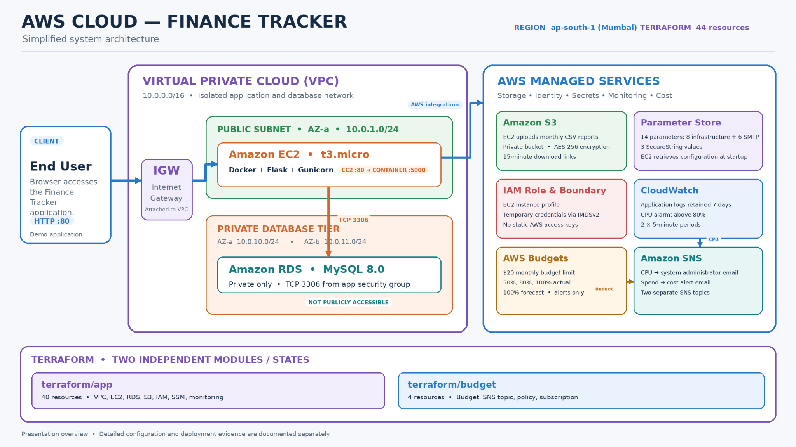
*High-level multi-tier AWS architecture topology: Public EC2 container host running Docker/Gunicorn/Flask in AZ-a, private Amazon RDS MySQL across isolated subnets in AZ-a and AZ-b, Amazon S3 monthly reports storage, SSM Parameter Store secrets, CloudWatch monitoring, and AWS Budgets cost guardrails.*

---

### 2. Financial Dashboard & CSV Ingestion
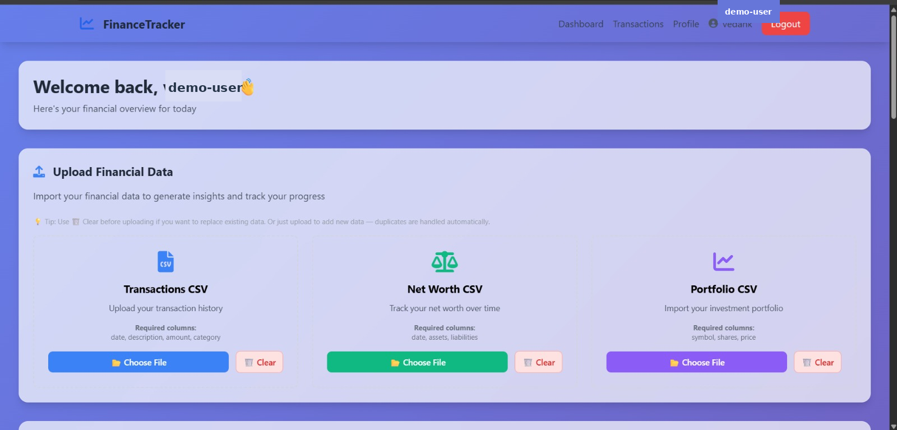
*Executive dashboard featuring real-time financial KPI cards (Total Balance, Monthly Income, Monthly Expenses, Net Savings), rapid transaction entry forms, and multi-format CSV upload interface supporting banking transactions, net worth tracking, and portfolio holdings.*

---

### 3. AI Insights, Budgets & Portfolio Allocation
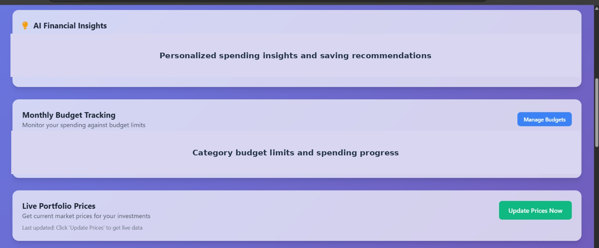
*Intelligent financial analytics displaying automated spending recommendations, monthly category budget tracking with visual percentage guardrails, and asset allocation breakdown.*

---

### 4. Monthly Cash-Flow Analytics
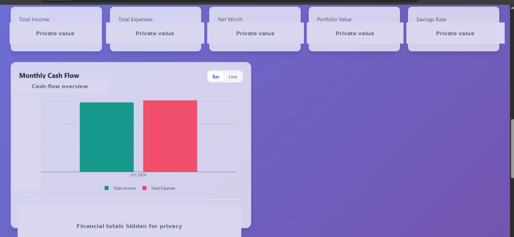
*Interactive income versus expenses cash-flow trajectory chart, net savings metrics, and monthly financial performance visualization.*

---

### 5. Recent Transaction Preview
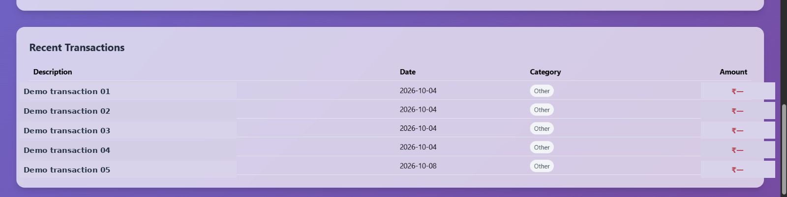
*Chronological recent activity ledger displaying categorized debits, credits, timestamps, and balance adjustments at a glance.*

---

### 6. Transaction History & Amazon S3 Report Export
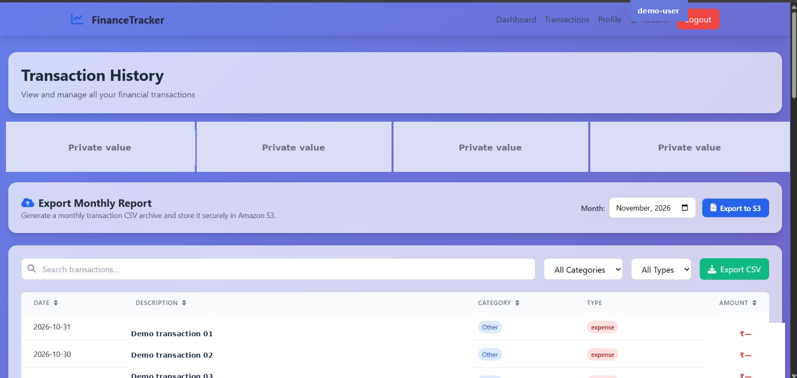
*Full transaction history with category filtering, monthly report compilation, and secure Amazon S3 cloud export delivering 15-minute pre-signed download URLs.*

---

### 7. Searchable Transaction Ledger
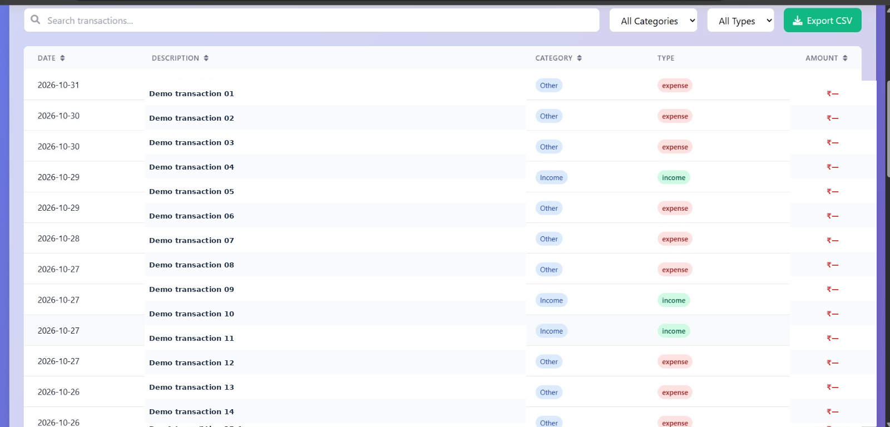
*Filterable and paginated transaction ledger supporting granular searches by date range, category, and amount with inline editing and record deletion.*

---

### 8. User Profile & Savings Goals
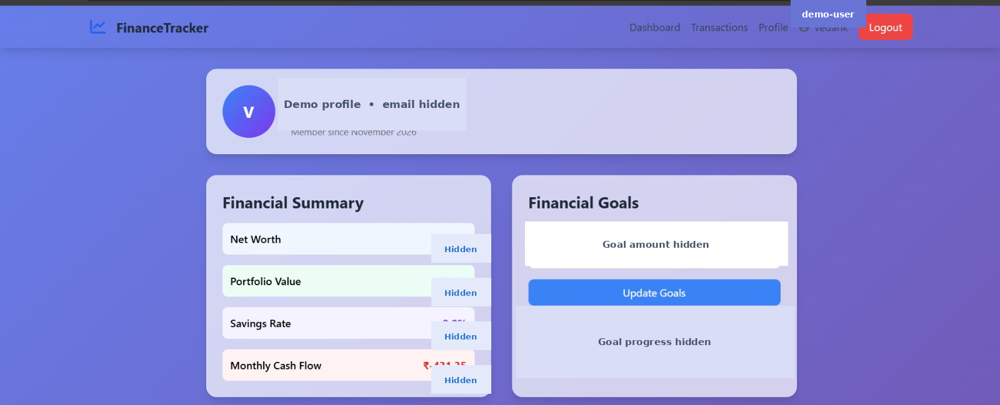
*User profile management interface displaying account summary statistics, password management, and milestone-based savings goals with progress tracking.*

---

### 9. Financial Health Assessment & Recommendations
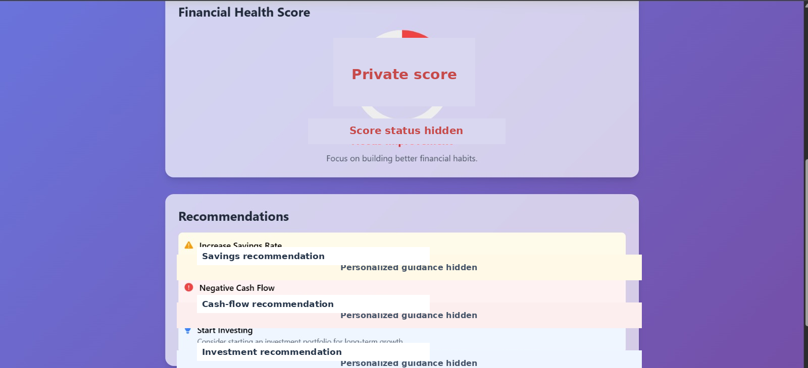
*Algorithmic financial health assessment scoring savings rate, budget discipline, and liquidity ratios with actionable, personalized recommendations.*

---

## 👨‍💻 Author & Acknowledgments

- **Author:** Vedank ([@vedank26](https://github.com/vedank26))
- **Course:** Cloud Computing Laboratory (CCL) Mini-Project
- **Academic Year:** 2026

*Licensed under the [MIT License](LICENSE).*
